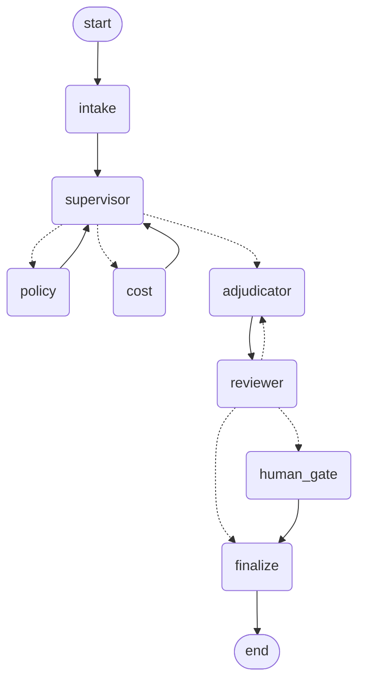

# Warranty goodwill desk

A multi-agent system built on LangGraph. A dealer submits a messy warranty
claim. A small team of agents decides whether to pay it, how much, and
whether a human has to sign off.


## Run it

```bash
python -m venv .venv && source .venv/bin/activate      # Windows: .venv\Scripts\activate
pip install -r requirements.txt
cp .env.example .env                                   # add your OPENAI_API_KEY
python run_cli.py CLM-1002                             # terminal, fast iteration
streamlit run app.py                                   # the UI
```

Start with `run_cli.py`. Debugging a graph through a Streamlit rerun loop is
miserable. Get the agents right in the terminal, then open the UI.

## The agents

| Agent | Type | Job |
|---|---|---|
| intake | LLM | Messy dealer email into a typed claim |
| supervisor | code | Routes to whichever finding is still missing |
| policy | LLM | Covered or not, citing a specific rule id |
| cost | code | Part price, labour, payout ceiling |
| adjudicator | LLM | Proposes outcome and payout |
| reviewer | LLM + code | Approves, or rejects with specific feedback |
| human gate | person | Signs off above threshold or on escalation |

Three of the eight nodes involve no model at all. That ratio is deliberate
and it is the main architectural point of the project.

## The graph



Dotted arrows are conditional edges, meaning a Python function looked at
state and chose the destination. Solid arrows are fixed.

Regenerate this any time with:

```python
from src.graph import build_graph
print(build_graph().get_graph().draw_mermaid())
```

## Where to read first

Read the files in this order. Each one has a long comment at the top
explaining why it exists, not just what it does.

1. `src/state.py` — the shared state and the append reducer. Start here.
2. `src/graph.py` — nodes, edges, conditional edges, the retry cap.
3. `src/agents.py` — the five agent functions.
4. `src/tools.py` — why so much of this is plain code.
5. `run_cli.py` — streaming and resuming after an interrupt.
6. `app.py` — the UI is a consumer of the same stream.

## The sample claims

| id | What it exercises |
|---|---|
| CLM-1001 | Clean approve inside warranty, crosses the human threshold on amount |
| CLM-1002 | Goodwill edge case, and a customer applying legal pressure that rule G-03 forbids using. Also breaches the G-02 cap, so the reviewer hard-rejects |
| CLM-1003 | Wear item, should be denied, should cost almost nothing to process |
| CLM-1004 | Unknown part, must escalate to a human under G-04 rather than guess |
| CLM-1005 | Missing fields everywhere, tests whether intake invents data |

CLM-1002 is the interesting one. It is built to trigger the retry loop and
to tempt a weak prompt into rewarding pressure.

## Turn on tracing

Put a `LANGSMITH_API_KEY` in `.env`. Every run then uploads a nested trace
tree showing which agent called which tool, with latency and token counts per
span. The in-app cost number tells you the total. The trace tells you where
it went. You want both, and understanding why you want both is worth more
than either number.


